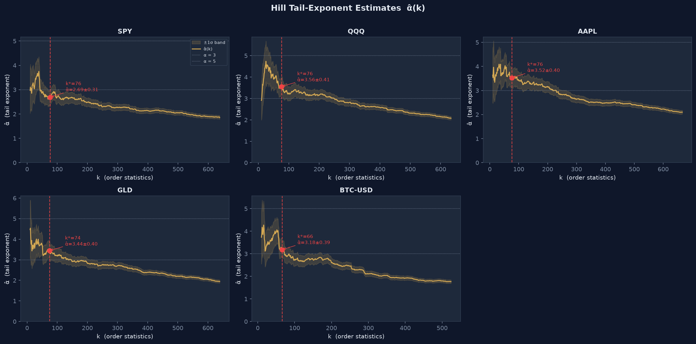
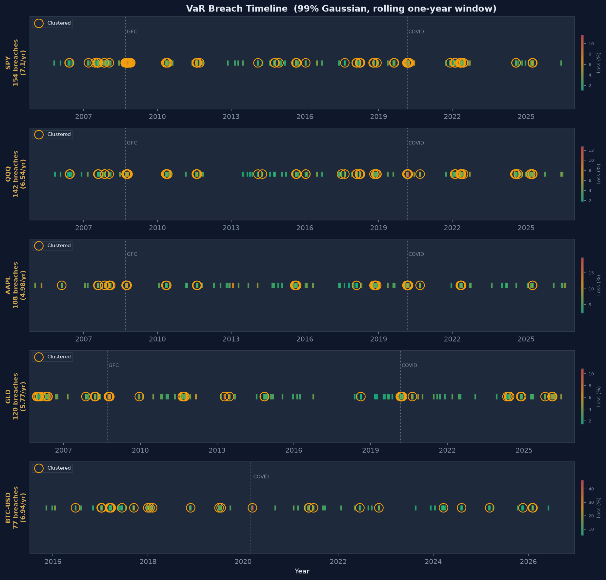
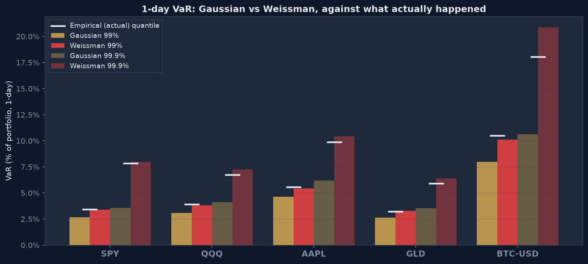

# Fat-Tail Risk & the Hill Estimator

> **The central question:** How fat are the tails of real market returns, and how badly does a Gaussian VaR miss them?

---

## Key result

Daily losses on SPY, QQQ, AAPL, GLD and Bitcoin all have power-law tails. At the chosen k (√n ≈ 76 days) the Hill tail exponent is **α̂ ≈ 2.7–3.6**; the estimate depends on k and falls to about 2.3–2.8 if the 5% largest losses are used (§5). A Gaussian VaR fitted to the same data misses those tails badly:

* A rolling 99% Gaussian VaR is breached **2–3× more often than it should be** (SPY: 7.1 breaches a year against 2.5 expected), and the Kupiec test rejects it for every asset.
* At 99.9%, the full-sample Gaussian VaR was exceeded on **38–53 days** per asset over ~20 years, against about **4–6** expected. The Weissman (Pareto) estimate was exceeded on **2–6** days. Both are **in-sample** checks: each VaR is fitted to the same data it is checked against, which favours the Weissman match, so read it as a check of fit rather than a forecast test. The rolling 99% breach counts above are out-of-sample.
* For SPY the Gaussian puts the 1-in-1,000-day loss at **3.6%**; the Weissman estimate is **8.0%**, and the realised 99.9% quantile was **7.8%** (all in-sample).





---

## Repo structure

```
01-tail-risk/
├── src/
│   ├── fetch_data.py          # Download & cache prices to CSV
│   ├── hill.py                # Core library: Hill estimator, Weissman VaR, Kupiec test
│   ├── analysis.py            # Full pipeline → summary_table.csv
│   ├── plots.py               # Figures → results/*.png
│   └── k_selection_study.py   # Monte Carlo comparison of rules for choosing k
├── notebooks/
│   └── walkthrough.ipynb
├── tests/
│   └── test_hill.py           # 21 unit tests (synthetic Pareto + Student-t validation, edge cases)
├── results/                   # CSV and PNG output (raw prices are git-ignored)
└── requirements.txt
```

---

## Data

| Asset | Ticker | Sample used | Observations per year |
|-------|--------|-------------|-----------------------|
| S&P 500 | SPY | Jan 2004 – Oct 2026 | 252 (trading days) |
| Nasdaq-100 | QQQ | Jan 2004 – Oct 2026 | 252 |
| Apple | AAPL | Jan 2004 – Oct 2026 | 252 |
| Gold | GLD | Nov 2004 – Oct 2026 | 252 |
| Bitcoin | BTC-USD | Sep 2014 – Oct 2026 | 365 (trades every day) |

Prices are fetched once with `python src/fetch_data.py` and saved to `results/prices_raw.csv` (not committed). The end date is pinned to 9 Oct 2026, so a fresh download reproduces the numbers below; `python src/fetch_data.py --latest` extends to today, and the results will then shift slightly. All downstream scripts read the CSV, so no internet is needed after the first run. The observations-per-year figure is inferred from the dates and used for the rolling window and for every per-year rate.

---

## Method

### 1  Log returns and losses

Daily log-returns: `r_t = ln(P_t / P_{t-1})`.
Losses: `L_t = max(0, −r_t)`. The Hill estimator uses only strictly positive losses; the Weissman VaR counts every day (see §7).

### 2  Gaussian rolling VaR (baseline)

For each day *t* we fit a Gaussian to the preceding year of returns (252 observations, 365 for Bitcoin), shifted by one day so there is no look-ahead, and read off the 99th percentile:

```
VaR_t = −(μ̂ − z_{0.99} · σ̂)
```

A breach occurs when `L_t > VaR_t`. Under a correctly specified model we expect 1% of days to breach: about **2.5 a year** for equities and **3.65 a year** for Bitcoin.

### 3  Kupiec test

The **Proportion of Failures (POF)** likelihood-ratio test (Kupiec, 1995) checks whether the observed breach rate is consistent with the nominal 1%. LR ∼ χ²(1) under H₀. Zero breaches is handled (it is strong evidence the VaR is too conservative), rather than returning NaN.

### 4  Hill estimator

Sort positive losses descending: X_(1) ≥ X_(2) ≥ … ≥ X_(n).
For each k, the Hill (1975) estimate of the tail exponent is:

```
         k
α̂(k) = ────────────────────────────────────
         Σ_{i=1}^{k} ln( X_(i) / X_(k+1) )
```

All k are computed at once from a cumulative sum of log-losses (no loop over k). Approximate ±1σ uncertainty: `α̂ / √k`.

### 5  Choosing k*

**k\* = √n**, where n is the number of days (≈ 76 for the 22-year equity samples).

Small k gives a noisy estimate; large k lets ordinary, non-tail days pull it down. On real returns the Hill plot never truly levels off: it keeps drifting down as k grows (see the Hill plots), so a rule that hunts for the "flattest" stretch ends up at large k with a badly biased estimate. `src/k_selection_study.py` checks this on Student-t returns with a known tail exponent, 150 samples the size of the SPY history:

| True α | Plateau rule (min rolling std) | **√n (used)** | 2% of n | KS distance |
|:------:|:------:|:------:|:------:|:------:|
| 2.5 | 1.89 (RMSE 0.62) | **2.44 (0.30)** | 2.38 (0.27) | 2.37 (0.56) |
| 3.0 | 2.09 (0.92) | **2.83 (0.33)** | 2.72 (0.36) | 2.82 (0.73) |
| 4.0 | 2.33 (1.67) | **3.45 (0.67)** | 3.28 (0.78) | 3.46 (0.88) |
| 5.0 | 2.50 (2.51) | **3.97 (1.11)** | 3.74 (1.29) | 3.94 (1.29) |

√n has the lowest error at α = 3, 4 and 5 and is close to the best at 2.5. Hill still reads low on Student-t data because its tail is only approximately Pareto, and the bias grows with α: about 0.06 at α = 2.5, 0.17 at 3, 0.55 at 4 and 1.0 at 5 (√n column). That bias is a property of the estimator, not of the k rule.

**The estimate depends on k.** On every asset the Hill plot slides from roughly 3–4 at small k to about 2 by k ≈ 600, so no single number is "the" tail exponent. The k* ± 20% check is narrow; the wider view below shows how far it moves:

| Ticker | k = 1% of n | **k\* = √n** | k = 2% of n | k = 5% of n |
|:-------|:----:|:----:|:----:|:----:|
| SPY | 2.79 | **2.69** | 2.61 | 2.26 |
| QQQ | 4.05 | **3.56** | 3.36 | 2.82 |
| AAPL | 3.98 | **3.52** | 3.27 | 2.69 |
| GLD | 3.26 | **3.44** | 3.22 | 2.74 |
| BTC-USD | 3.86 | **3.18** | 2.90 | 2.49 |

The conclusion that tails are power-law, far heavier than a Gaussian (whose tail decays faster than any power law), holds at every k; the exact value, and which moment band it falls in (§6), does not.

### 6  Interpreting α̂

For a power-law tail, moments of order below α exist and moments of order α and above are infinite.

| α̂ range | Implication |
|---------|-------------|
| α > 4   | Mean, variance, skewness and kurtosis all finite |
| 3 < α ≤ 4 | **Infinite kurtosis** (4th moment does not exist); the classic range for financial returns |
| 2 < α ≤ 3 | Variance finite, but **the 3rd moment (skewness) is infinite** |
| α ≤ 2   | **Infinite variance** |

Equity returns are typically reported in roughly **3 < α < 5**.

### 7  Weissman tail-VaR

Using the selected k* and α̂, the Weissman (1978) estimator extrapolates to small tail probabilities:

```
VaR_p  =  X_(k*+1)  ·  ( k* / (n · p) )^(1/α̂)
```

where p = 1 − confidence is a **per-day** probability, so n is the total number of days (including gain and zero-loss days), not the number of positive losses. It is compared to the Gaussian at 99% and 99.9%, and both are checked against the realised loss quantiles.

---

## Results

### Summary table

| Ticker | Years | α̂ (Hill) | ± 1σ | α̂ at k*−20% / +20% | k* | Breaches/yr (obs) | Expected/yr | Kupiec p |
|:-------|:-----:|:--------:|:----:|:-----------:|:--:|:-----------------:|:-----------:|:--------:|
| **SPY** | 21.7 | **2.69** | 0.31 | 2.80 / 2.88 | 76 | **7.09** | 2.52 | 3e-28 |
| **QQQ** | 21.7 | **3.56** | 0.41 | 3.75 / 3.33 | 76 | **6.53** | 2.52 | 5e-23 |
| **AAPL** | 21.7 | **3.52** | 0.40 | 3.57 / 3.55 | 76 | **4.97** | 2.52 | 2e-10 |
| **GLD** | 20.8 | **3.44** | 0.40 | 3.26 / 3.33 | 74 | **5.76** | 2.52 | 1e-15 |
| **BTC-USD** | 11.1 | **3.18** | 0.39 | 3.96 / 2.87 | 66 | **6.96** | 3.65 | 3e-07 |

"Years" counts the days with a VaR forecast, i.e. after the first year used to fit the window.

| Ticker | Gaussian 99% | Weissman 99% | **Actual 99%** | Gaussian 99.9% | Weissman 99.9% | **Actual 99.9%** | Days > Gaussian 99.9% | Days > Weissman 99.9% | Expected |
|:-------|:----:|:----:|:----:|:----:|:----:|:----:|:----:|:----:|:----:|
| **SPY** | 2.69% | 3.40% | **3.43%** | 3.58% | 8.00% | **7.83%** | **53** | 6 | 5.7 |
| **QQQ** | 3.09% | 3.80% | **3.92%** | 4.12% | 7.26% | **6.73%** | **49** | 5 | 5.7 |
| **AAPL** | 4.62% | 5.43% | **5.55%** | 6.18% | 10.44% | **9.89%** | **38** | 5 | 5.7 |
| **GLD** | 2.64% | 3.28% | **3.23%** | 3.52% | 6.41% | **5.91%** | **48** | 5 | 5.5 |
| **BTC-USD** | 7.98% | 10.12% | **10.51%** | 10.64% | 20.86% | **18.03%** | **40** | 2 | 4.4 |

VaR figures are 1-day log-losses. The Gaussian and Weissman columns here are full-sample estimates, and "Actual" is the empirical quantile of the same sample, so this is an in-sample check of fit, not a forecast backtest.

### Key observations

1. **Gaussian VaR fails systematically.** The rolling 99% VaR is breached 2.0–2.8× more often than the nominal 1% (1.9× for Bitcoin, against its 365-day calendar). The Kupiec test rejects for every asset (p < 10⁻⁶).
2. **The tail is a power law with α̂ around 3.** At k* SPY's α̂ ≈ 2.7 sits near the boundary where skewness stops being finite; QQQ, AAPL, GLD and Bitcoin sit at 3.2–3.6, in the infinite-kurtosis range. These bands depend on k (§5): at 5% of n every asset falls to 2.3–2.8. Bitcoin's estimate is the least stable (3.96 to 2.87 across k*±20%) because its history is shortest.
3. **The gap is largest exactly where it matters.** At 99.9% the Gaussian is exceeded 7–9× more often than it should be. The Weissman estimate tracks the realised 99.9% quantile within about 0.2–3 percentage points and is exceeded about as often as expected.
4. **Breaches cluster.** 55% of SPY's breaches come within the 10 trading days *after* an earlier breach, against 25% if breaches were independent at SPY's 2.8% rate. Counting both directions (another breach within 10 days before or after), it is 73% against 43%. The worst years are spread across stress episodes: 2008 (20), 2022 (17), 2007 and 2018 (16 each) and 2020 (14). This contradicts the i.i.d. assumption behind both the Gaussian model and the Kupiec test.

---

## Running the project

```bash
# 1. Install dependencies (first time only)
pip install -r requirements.txt

# 2. Download and cache data (pinned end date; add --latest for data through today)
python src/fetch_data.py

# 3. Run analysis → summary_table.csv + breach CSVs
python src/analysis.py

# 4. Generate all figures → results/*.png
python src/plots.py

# 5. Run unit tests
pytest tests/ -v

# 6. (Optional) Re-run the k-selection simulation
python src/k_selection_study.py
```

---

## Limitations & extensions

1. **k selection is a rule of thumb.** √n performed best of the rules tried on Student-t data, but no rule is right for every distribution. Sensitivity to k is reported via α̂ at k* ± 20% and at 1%, 2% and 5% of n (§5); across that range the exponent moves by up to about 1.2.

2. **Hill assumes i.i.d. observations.** Real returns cluster in volatility (GARCH effects), which biases the estimator and its standard error. A natural extension: filter returns through a GARCH(1,1) model and apply Hill to the standardised residuals.

3. **Power-law tail assumption.** Hill is exact only for Pareto tails. When the tail is power-law only asymptotically (as for Student-t), Hill is biased low in finite samples, and more so the thinner the tail: in the §5 simulation, about 0.06 at α = 2.5, 0.17 at 3, 0.55 at 4 and 1.0 at 5.

4. **The tail comparison is in-sample.** The Weissman and full-sample Gaussian VaRs are fitted on the same data they are checked against. A rolling, out-of-sample Weissman VaR would be the fair counterpart to the rolling Gaussian.

5. **Rolling VaR uses a fixed one-year window.** It reacts slowly to volatility changes. An EWMA or GARCH volatility forecast would adapt faster.

6. **Bitcoin history is shorter.** About 12 years of daily data (11 with a VaR forecast) limits the precision of its tail estimate.

---

## References

* Hill, B. M. (1975). A simple general approach to inference about the tail of a distribution. *Annals of Statistics*, 3(5), 1163–1174.
* Weissman, I. (1978). Estimation of parameters and large quantiles based on the k largest observations. *Journal of the American Statistical Association*, 73(364), 812–815.
* Kupiec, P. H. (1995). Techniques for verifying the accuracy of risk measurement models. *Journal of Derivatives*, 3(2), 73–84.
* Danielsson, J., Ergun, L. M., de Haan, L., & de Vries, C. G. (2016). Tail index estimation: quantile-driven threshold selection. Working paper. (KS-distance rule compared in §5.)

---

*Not financial advice. Past performance does not guarantee future results.*
