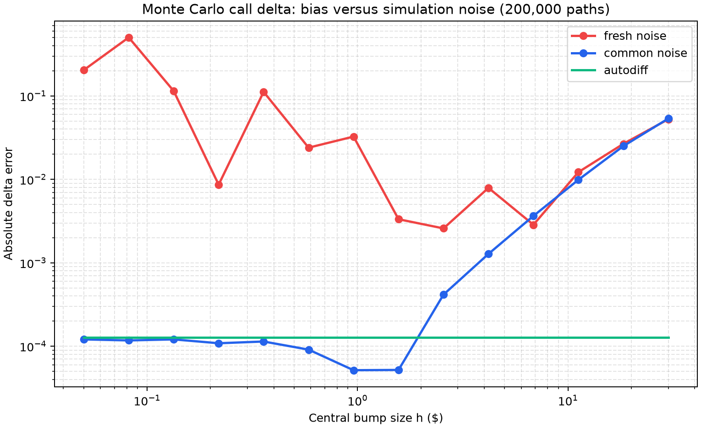

# Option Greeks with Monte Carlo & JAX

> **The central question:** How do simulation noise, bump size, and autodiff affect estimates of a European call's delta and gamma?

## Key result: delta error versus bump size



The fresh-noise central difference becomes unstable as `h` shrinks: independent pricing noise is divided by `2h`. Reusing the same normal draws cancels most of that noise, leaving central-difference bias as the bump grows. Pathwise `jax.grad` has no bump-size choice; its estimate still has Monte Carlo sampling error. The fixed seed makes this experiment reproducible.

The experiment saves each delta estimate and standard error in [`results/delta_estimates.csv`](results/delta_estimates.csv), and the price/delta/gamma comparison in [`results/greek_estimates.csv`](results/greek_estimates.csv). To regenerate the plot and tables:

```bash
python -m venv .venv
source .venv/bin/activate
pip install -r requirements.txt
python src/run_analysis.py
pytest -q
```

## Pricing model

Under the risk-neutral measure the terminal stock is sampled as

```
S_T = S_0 exp((r - σ²/2)T + σ√T Z),  Z ~ N(0, 1)
```

The discounted European call value is the sample mean of `exp(-rT) max(S_T - K, 0)`. The default experiment uses 200,000 paths, `S0 = K = 100`, `r = 5%`, `σ = 20%`, `T = 1`, and 64-bit JAX floats. The seed is 2026. Every estimate reports its standard error (sample standard deviation divided by the square root of its path count).

## Three delta estimates

* **Fresh-noise bump:** estimates the central difference with separate normal draws for the up and down repricings. Its standard error grows approximately as `1/h`.
* **Common-random-number bump:** uses identical normal draws for both repricings. This strongly reduces variance; the remaining approximation has central-difference bias.
* **Pathwise autodiff:** differentiates the mean simulated payoff with `jax.grad`. For this payoff, its expected derivative equals the Black-Scholes delta `N(d1)`.

The graph plots absolute error against bump size on a log-log scale; the autodiff error is a horizontal reference because it does not depend on `h`. The accompanying CSV includes standard errors so sampling uncertainty is visible alongside the realized errors.

## The gamma trap

The call payoff is piecewise linear. On every simulated path its second derivative with respect to spot is zero except at the payoff kink. Since a continuous stock distribution hits that kink with probability zero, `jax.grad(jax.grad(price))` reports exactly zero for gamma despite the positive Black-Scholes gamma.

`run_analysis.py` demonstrates this failure and compares three repairs against the exact Black-Scholes gamma:

1. **Likelihood ratio:** transfer both derivatives to the sampling density. Its per-path weight is `(Z² - Zσ√T - 1) / (S0² σ² T)`. It is unbiased for the hard payoff, though it can be noisy.
2. **Softplus payoff:** replace `max(x, 0)` with `τ log(1 + exp(x/τ))`, then differentiate twice. This restores pathwise curvature but introduces a controllable smoothing bias.
3. **Finite difference of pathwise delta:** bump the autodiff delta with common random numbers. This recovers curvature statistically, with a bump-size/variance trade-off of its own.

The formulas are tested against the closed-form Black-Scholes price, delta, and gamma. Tests also assert that naive pathwise gamma is zero, making the failure explicit rather than silently accepting it as a valid Greek.
